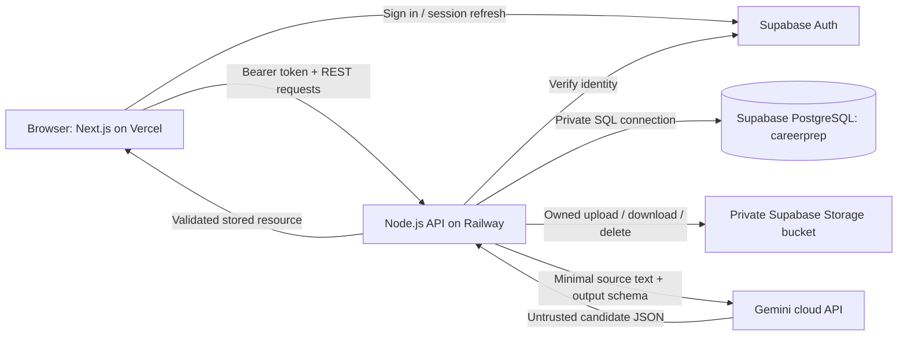

# CareerPrep AI technical design

Updated October 21, 2026. Companion documents: [pitch](01-project-pitch.md), [database](03-database-reference.md), [decisions](04-discovery-and-decisions.md).

This is the original design baseline. The implementation inventory below describes the repository before Sprint 2. Track later implementation and verification in the [sprint delivery record](06-sprint-log.md); a PR implementation does not establish hosted deployment or complete later AI workflows.

Unless described as implemented or confirmed, this document is a proposed implementation contract. Numeric product limits, rubrics, and API routes beyond the three current endpoints require implementation and team review.

## 1. Product scope and acceptance

The product helps a job seeker improve a resume and practice answering questions grounded in their experience and an optional target job. The user remains responsible for reviewing extracted facts and deciding how to use feedback.

### Full proposed user journey

1. Create an account or sign in using Supabase Auth.
2. Upload an owned PDF or DOCX resume to private storage.
3. Extract readable text, then use AI to produce a structured resume profile; save the validated profile.
4. Review and correct that profile before generating an analysis.
5. Receive specific strengths, weaknesses, missing sections, and recommendations with a practice score.
6. Optionally create a saved job description and compare it with a selected resume.
7. Start a text interview based on that resume and, optionally, that job description.
8. Answer a short, stable set of generated questions.
9. Receive validated per-answer feedback and component scores.
10. Complete the session and view a backend-computed overall score and saved history.

### Proposed scope boundaries

**Confirmed initial audience:** college students and fresh graduates seeking entry-level jobs. The proposed first release is English-language, text-based practice with five questions per interview. Feedback should recognize projects, coursework, internships, and volunteer work as possible evidence instead of assuming professional employment history. Interview difficulty should fit an entry-level role and the supplied context. Documented schema capacity is larger than the initial UI scope.

OCR, voice/video interviews, recruiter dashboards, resume rewriting, web job scraping, external job applications, vector search, and autonomous agents are outside the proposed release. Structured extraction is the qualifying AI category. **Confirmed final scope includes both job matching and mock interviews**, built after resume analysis. The target deadline is **November 17, 2026**. An individual user may skip job-description input; implementing matching is still required.

### Acceptance by feature

| Feature | Observable acceptance condition |
| --- | --- |
| Accounts | A valid Supabase identity maps to one application profile. Expired/invalid tokens are rejected. |
| Resume CRUD | A user uploads, lists, views, renames, and deletes a saved resume. A second user cannot access it. |
| File handling | Supported readable PDF/DOCX succeeds; oversized, malformed, encrypted, or image-only files get a clear failure. Files remain private. |
| Extraction | A structured profile is saved, missing fields remain unknown, and the user can correct extraction errors. |
| Analysis | The backend validates a structured result, computes its aggregate score, stores provenance, and displays evidence-based feedback. |
| Matching | A saved resume/job pair produces requirement-by-requirement assessments and a transparent heuristic match score. |
| Interview | Questions are saved in stable order, answers persist, evaluated questions have feedback, and only a complete session receives an overall score. |
| Recovery | Failed AI calls preserve files/answers and allow a bounded retry without duplicate successful records. |
| Privacy | A delete removes related database results and coordinates cleanup of private files; secrets and source documents are absent from logs. |

## 2. Current implementation inventory

| Area | Repository evidence | Limit or missing behavior |
| --- | --- | --- |
| Frontend | `src/app/page.tsx` calls `/health` and `/ai-test`; displays service indicators. | No accounts, upload, CRUD, analysis, matching, or interview screens. Backend status starts as connected and may remain misleading on fetch failure. |
| Backend | `backend/src/server.js` uses native `node:http`, JSON responses, origin headers, Supabase REST, and Gemini REST. | No body parser, authenticated routes, private-table SQL connection, runtime schemas, explicit upstream timeouts, or application services. |
| Database | Eight private application tables and public `app_config` in two migrations. | Migration comments/identity fields assume Laravel; Node currently accesses only `public.app_config`. |
| AI | `/ai-test` lists accessible models and attempts a minimal text request. | It checks HTTP success, not the generated text/body or structured business output. It can select another available model after a 404. |
| Environment | Frontend/backend example files; `.gitignore` excludes local environment values. | `npm start` does not automatically read `backend/.env`. Future auth/SQL/storage variables are absent from templates. |
| Deployment/CI | Railway config and GitHub Actions; root README lists Vercel/Railway URLs. | Deployment availability and CI results were not checked. Railway healthcheck `/` proves only that the process responds. |
| Prototype | `CareerPrepAI/` is a separate Vite/TypeScript starter, built in CI. | It is not the main Next.js interface or a completed product UI. |

The owner's newer report confirms that a Gemini key was tested. The root README's older authorization-failure checklist is therefore stale. No key contents or local secret files were read during documentation work.

## 3. Confirmed architecture and trust boundaries

**Confirmed:** retain Node.js; use Supabase Auth. The existing Laravel notes are historical design intent and must be reconciled through a follow-up migration and documentation updates.



The browser may contact Supabase Auth to establish a session. All application-table operations and AI requests go through the Node API. Application ownership comes from the verified token and the server-side profile mapping, never a submitted `user_id`. The private `careerprep` schema is not exposed through the Supabase Data API.

Use a dedicated PostgreSQL runtime role with only the required schema/table/sequence privileges, plus a separate migration identity. The current anon REST key cannot perform private-schema CRUD. Select a direct or session-pooler connection based on the deployed backend's network connectivity; verify TLS and pool limits. Supabase documents these connection choices in its [PostgreSQL connection guide](https://supabase.com/docs/guides/database/connecting-to-postgres).

### Authentication and authorization

1. The Auth client obtains a session using Supabase's supported client flow.
2. The browser sends `Authorization: Bearer <access-token>` with application requests.
3. Node validates the token using the supported Supabase verification flow; merely decoding JWT claims is insufficient. It rejects invalid/expired tokens.
4. Resolve or transactionally create `careerprep.users` using the verified Supabase subject and a unique `auth_user_id`. Populate identity attributes from verified identity data, not an arbitrary request subject.
5. Query each resource with the resolved application `user_id`. Traverse question/answer ownership through its session.
6. Return an owned-resource 404 for inaccessible IDs and 401 for invalid authentication. Composite database foreign keys provide an additional ownership consistency check.

The current CORS response allows only `GET,POST,OPTIONS` and `Content-Type`. The new API requires approved origins, `PATCH`, `PUT`, `DELETE`, `Authorization`, and the proposed `Idempotency-Key` header. CORS configuration does not replace authentication. Authentication SDK selection, browser session persistence, sign-out, refresh behavior, and any cookie/CSRF strategy must be settled during the authentication slice.

For storage, check ownership in Node before using privileged credentials. A service role bypasses Storage RLS and must remain server-only; see [Supabase Storage access control](https://supabase.com/docs/guides/storage/security/access-control). Prefer backend-mediated file access for the initial release. Never make the resume bucket public. If signed download links are introduced, issue short-lived links only after an ownership check.

## 4. Backend structure and frontend screens

Retain the existing Node.js/JavaScript runtime and separate API. As features are added, split routing, authentication, request schemas, database access, storage/parsing, AI provider access, and orchestration into separate modules. The exact directory organization and any routing library are implementation choices, not new requirements.

The current backend manifest has no external dependencies. A PostgreSQL driver, Auth client/verification mechanism, multipart parser, PDF parser, DOCX parser, and runtime JSON validator still need selection. Add only the dependencies needed by each delivery slice. Gemini can continue using REST through `fetch`; an SDK is optional.

| Proposed screen | Primary data/actions | Required UI states |
| --- | --- | --- |
| Sign-in/sign-up | Supabase Auth, resolve `/me` | Pending, validation error, expired session, success |
| Resume dashboard | List/upload/rename/delete resumes | Empty, uploading, saved, failed, loading |
| Resume detail | File metadata, extracted text/profile review | Pending, processing, needs correction, confirmed, failed |
| Resume analysis | Start/read analysis, show rubric and evidence | No run, processing, completed, failed/retryable |
| Target job / match | Save description, choose resume, start comparison | Validation error, processing, missing evidence, completed |
| Mock interview | Choose context, ordered questions, typed answers | Generating, in progress, saving, evaluating, retry, completed |
| History | Stored runs and source versions | Empty, loading, older-source label, completed/failed |

Rendering treats AI and user text as plain text. Raw generated HTML must not be inserted into the page. Frontend state follows backend processing status; a browser timeout must not overwrite a persisted successful run with a guessed failure.

## 5. Proposed REST contract

The existing routes stay unversioned for diagnostics. All new application routes below use `/api/v1`. They are designs, not endpoints that already exist.

### Existing endpoints

| Method/path | Actual behavior |
| --- | --- |
| `GET /` | Returns the backend service name and `status: running`. |
| `GET /health` | Reads public project metadata; returns 200 with `not_configured` if environment settings are missing, or 503 for a failed database read. It does not exercise private tables or writes. |
| `POST /ai-test` | Makes a small Gemini request; returns configured/connected/error states. Currently unauthenticated and has no application usage limiter. Restrict or disable public paid probes before wider release. |

The root README mentions `/api/health` in one migration paragraph, but the implemented backend path is `/health`.

### Accounts and core resume CRUD

| Method/path under `/api/v1` | Request | Result |
| --- | --- | --- |
| `GET /me` | Verified token | Resolve/create the caller's application profile; return only safe profile fields. |
| `POST /resumes` | Multipart file and optional display title | Validate and store file/metadata; 201 with pending resume. A separate extraction action avoids making upload depend on an LLM response. |
| `GET /resumes` | Cursor/limit | Owned, paginated resume metadata; 200. Default limit 20, maximum 100 (proposed). |
| `GET /resumes/:id` | Owned ID | Metadata and extraction status; 200 or 404. |
| `PATCH /resumes/:id` | Display title only | Update allowlisted metadata; 200. Client cannot change ownership, storage path, processing status, or AI scores. |
| `DELETE /resumes/:id` | Owned ID | Delete workflow and file cleanup; 204 only once required cleanup finishes. Failures remain visible/retryable. |
| `GET /resumes/:id/file` | Owned ID | Authorized download; no permanent public file URL. |
| `POST /resumes/:id/extraction` | Idempotency key | Parse source, extract/validate/store profile; 200 on success or typed error with the saved resume status. |
| `GET /resumes/:id/profile` | Owned ID | Current structured profile with provenance and revision. |
| `PATCH /resumes/:id/profile` | Allowlisted profile corrections and confirmation | Validate/store edits and increment revision. This is an additional CRUD update surface; it never rewrites the uploaded file. |

Uploading a replacement creates a new resume. `display_title` and structured profile storage are proposed schema additions. A metadata rename must not change the opaque storage path.

### Analyses, jobs, and interviews

| Method/path under `/api/v1` | Contract |
| --- | --- |
| `POST /resumes/:id/analyses` | Requires a confirmed profile; create a versioned, validated analysis. Return 201 on success. |
| `GET /resumes/:id/analyses`, `GET /analyses/:id` | Owned history and individual stored result. |
| `POST /job-descriptions` | Create title/company/description; 201. |
| `GET /job-descriptions`, `GET /job-descriptions/:id` | Owned list/detail; 200. |
| `PATCH /job-descriptions/:id` | Update an unreferenced description. If results reference it, return 409 and offer to save a new description instead. |
| `DELETE /job-descriptions/:id` | Confirm the documented dependent-result cascade; coordinate with any in-progress run. |
| `POST /job-matches` | Owned resume ID and owned job ID; validate requirements/assessments, compute score, persist; 201. |
| `GET /job-matches`, `GET /job-matches/:id` | Owned history/detail. |
| `POST /interview-sessions` | Owned resume ID, optional owned job ID, proposed count five; create session and all validated ordered questions atomically; 201. |
| `GET /interview-sessions`, `GET /interview-sessions/:id` | Owned history; detail includes ordered questions and safe saved answer results. |
| `PUT /interview-questions/:id/answer` | Save one current answer; 201 on first save, 200 on allowed revision. Evaluated answers are locked for that attempt. |
| `POST /interview-answers/:id/evaluation` | Requires saved answer and active owned session; evaluate and store feedback; 200. |
| `POST /interview-sessions/:id/complete` | Require all expected questions and successful evaluations; calculate aggregate in backend, mark completed; 200 or 409. |
| `PATCH /interview-sessions/:id` | Allow transition from in-progress to abandoned; reject arbitrary status/score updates. |

Automatic extraction/analysis may be triggered by the UI after upload, but they remain separate backend operations. Job descriptions are optional input for an interview, not a dependency of resume analysis.

### Representations and execution model

Successful responses return saved resource IDs, status, timestamps, relevant data, and safe provenance. Serialize PostgreSQL bigint IDs as decimal strings to avoid JavaScript numeric precision loss. Return a trace/request ID with errors.

Proposed error shape:

```json
{
  "error": {
    "code": "AI_OUTPUT_INVALID",
    "message": "The analysis could not be validated. You can retry.",
    "retryable": true,
    "request_id": "opaque-trace-id"
  }
}
```

For the initial demo, use bounded synchronous AI requests with persisted run status. The frontend reads the resource after a network timeout to learn whether work finished. This design does not promise durable background execution; a restarted process can interrupt a run. Mark stale processing runs failed using a defined timeout on recovery. Add `202 Accepted`, a worker, and polling only if measured latency and the deadline justify that additional architecture.

Proposed AI timeout is 30 seconds per provider attempt, with at most one retry for selected transient failures within a bounded operation deadline. Actual hosting/request limits and parsing latency must be measured. Persist pending/processing state before contacting Gemini, avoid holding a database transaction open during network calls, then atomically commit validated results and final status.

Use a request key unique to the user and AI operation. Repeated submissions of the same key return the existing run or its status. A unique constraint and conditional status update prevent two calls from processing the same run concurrently. This requires schema work; it is not implemented by the existing status columns alone.

## 6. AI processing and output contracts

### Shared boundaries

Each task has a server-owned prompt version, output schema, rubric version where applicable, and permitted input sources. The model cannot choose the user, SQL query, storage path, endpoint, or ownership relation. Resume/job/answer text is quoted as untrusted data; instructions embedded in it must not override the task.

Use an explicitly configured, tested model for business workflows. Do not copy the connectivity probe's arbitrary-model fallback into scoring. Record the actual model and prompt/rubric versions for every saved result. Structured-output configuration is supported by Gemini, but source grounding and semantic validation remain backend responsibilities; see [the official structured-output guide](https://ai.google.dev/gemini-api/docs/structured-output).

For each result: check provider status, safely parse the response, detect absent/blocked/truncated content, parse JSON, enforce a closed runtime schema, check source evidence, compute derived fields, and store the accepted application representation. Do not persist an invalid candidate as completed or rely on a TypeScript type assertion as runtime validation.

### A. File text and resume profile extraction

1. Accept one PDF/DOCX file; validate MIME, extension, and actual format. Use an opaque per-user storage key.
2. Apply a maximum of 10 MiB, matching the migration. Proposed additional caps: 50 pages and 60,000 extracted characters. Reject excess input clearly rather than silently dropping content that may affect scores.
3. Apply parser resource/time limits. Handle corrupt/encrypted PDFs, unsafe or excessive DOCX archive expansion, and documents with no usable text. Choose parsers against representative anonymized samples before committing to them.
4. Save extracted text and its status. Separate deterministic file-to-text parsing from LLM interpretation; the SQL `extraction_status` tracks the combined workflow, with `extraction_error` identifying its failed stage.
5. Ask Gemini for fields such as `summary`, `skills[]`, `education[]`, `experience[]`, and `projects[]`. Fields absent from the source stay null/empty with an explanatory warning.
6. Include evidence excerpts or source offsets for extracted claims. Validate that references resolve to the source; that establishes traceability, not complete truth verification. Reject unsupported claims where detected and ask the user to review uncertain entries.
7. Normalize whitespace and duplicate skills without inventing credentials. Save the structured profile separately from raw text, with model/schema/prompt versions and a profile revision.
8. Require user review/confirmation before analysis. Mark later user corrections as user-provided rather than claiming they were extracted from the file.

The existing schema saves only raw extracted text; `resume_profiles` is a proposed migration. Proposed profile limits are 50 skills, 20 education entries, 30 experience entries, 30 projects, and bounded text per item; the exact runtime schema must be published alongside implementation.

### B. Resume analysis

Inputs: immutable document text, the confirmed profile revision, and a published rubric. Output: component scores, summary, strengths, weaknesses, missing sections, and actionable recommendations. Every factual observation cites relevant evidence; formatting judgments must be limited to information actually available from the text parser.

The backend validates score bounds and recommendation structure, computes the overall score, and saves a source snapshot/revision and provenance. It rejects an unsupported component or flags the run for correction; it does not hide invalid output by clamping values.

Proposed feedback-item shape: `category`, `observation`, `evidence_excerpt` (nullable for genuinely missing content), `recommendation`, and `priority`. Validate priority against a fixed enum and cap each feedback array at ten items. A missing-section finding must explain what was not found instead of fabricating a source quote.

### C. Resume-to-job matching

Inputs: confirmed resume profile/source and a saved job description. The structured result identifies distinct stated requirements, supporting resume evidence, and one of `met`, `partial`, `not_evidenced`, or `unknown` per requirement. Store the assessments as proposed structured data and derive matching/missing skills for the existing columns.

The backend rejects invented requirements or evidence, deduplicates requirements, computes the score using the declared rule, and saves the explanation. A result with no usable requirements produces an insufficient-information response and no numeric score. Describe `not_evidenced` as absent from the resume, not proof the person lacks the skill. Never include protected personal attributes in matching criteria.

### D. Interview question generation

Use the selected resume and optional job description to produce the requested count of questions, each with `question_number`, allowed `question_type`, `question_text`, and evidence/context. Check count, unique contiguous numbering, length, duplicates, allowed categories, and grounded context. Persist all questions in a transaction, then move the session to `in_progress`; failed generation must not leave a partially usable interview.

### E. Answer evaluation and session scoring

Input: one saved question, its answer, the session's frozen source context, and the rubric. Validate relevance, clarity, completeness, examples, and applicable technical scores plus feedback/strengths/suggestions. The backend computes each overall score. An unsubmitted answer is absent; a failed evaluation is not a zero score.

After every expected answer is evaluated, compute the session score and compose its summary from stored results. This final aggregation does not need an additional AI call. Evaluated answers are immutable for that attempt; a new interview is a new attempt. The current schema allows one answer per question and has no attempt history.

## 7. Proposed scoring rules

These rules are proposed versioned heuristics for practice feedback. The instructor/team must approve them and evaluate sample outputs before submission. AI component judgments can vary even when backend arithmetic is deterministic.

| Score | Proposed backend calculation |
| --- | --- |
| Resume `resume-v1` | Four validated components, each 0–100: completeness 25%, clarity 25%, evidence of achievements 30%, organization observable from text 20%. Weighted sum rounded to two decimals. No claim of visual layout inspection. |
| Job match `job-match-v1` | Equal weight per distinct job requirement; `met` = 1, `partial` = 0.5, `not_evidenced`/`unknown` = 0. Score = `100 * sum(credits) / requirement_count`, rounded to two decimals. Show unknowns and coverage alongside the score. Zero usable requirements means null score. |
| Interview answer `interview-v1` | For applicable components: relevance 30%, clarity 20%, completeness 20%, examples 20%, technical accuracy 10%. For nontechnical questions, technical score is null and the remaining weights are divided by 0.9. |
| Interview overall | Arithmetic mean of all expected, successfully evaluated answer overall scores. Do not publish a completed overall score for an incomplete or failed session. |

Example arithmetic: a resume with components 80, 70, 60, and 90 gets `80*0.25 + 70*0.25 + 60*0.30 + 90*0.20 = 73.50`. A job with four requirements assessed met, partial, not evidenced, met gets `100*(1+0.5+0+1)/4 = 62.50`.

Existing tables have aggregate score checks but lack resume component storage, requirement-level match assessments, and an answer-level rubric version. Those additions are listed in the database reference. A numeric SQL constraint alone does not ensure a result is complete or meaningful.

## 8. Validation, failures, and recovery

| Condition | Proposed HTTP/code | Persistence and user behavior |
| --- | --- | --- |
| Malformed JSON, invalid identifier | 400 `INVALID_REQUEST` | Reject before invoking parsers, database mutations, or AI. |
| Invalid/expired token | 401 `UNAUTHENTICATED` | Reauthenticate; no application result exposed. |
| Missing/unowned resource | 404 `RESOURCE_NOT_FOUND` | No cross-user information. |
| Unsupported document type | 415 `UNSUPPORTED_DOCUMENT` | Explain supported formats; no AI call. |
| Upload too large | 413 `FILE_TOO_LARGE` | Enforce during streaming as well as against claimed length. |
| Empty/invalid fields, unreadable PDF | 422 `VALIDATION_FAILED` / `DOCUMENT_UNREADABLE` | Return safe field errors; preserve a saved source with failed status if upload already succeeded. |
| Wrong state, concurrent run, source edit in use | 409 `INVALID_STATE` | Return current state or require a new source version. |
| Local usage cap/provider quota | 429 `RATE_LIMITED` | Show retry timing where known; avoid uncontrolled automatic retries. |
| Invalid provider output or blocked content | 502 `AI_OUTPUT_INVALID` / `AI_NO_USABLE_RESULT` | Mark run failed; no successful score. One bounded repair attempt may be allowed if budget permits. |
| Missing provider configuration/auth failure | 503 `AI_UNAVAILABLE` | Operator action required; no automatic retry loop with a rejected key. |
| Provider/network timeout | 504 `AI_TIMEOUT` | Preserve input and saved run; permit a bounded retry after checking current state. |
| Database/storage outage | 503 `DEPENDENCY_UNAVAILABLE` | Preserve consistency; do not report success before storage and required SQL changes finish. |
| Unexpected internal exception | 500 `INTERNAL_ERROR` | Catch at route boundary, log safe trace data, return generic message. |

Proposed request limits: JSON body maximum 1 MiB; job description and answer text 1–30,000 characters, matching SQL constraints; display title 1–150 characters. Reject unknown mutable fields and cross-user references. Request IDs, status transitions, and small error metadata may be logged; raw resumes, answers, provider responses, tokens, keys, and full database URLs must be redacted.

Retry only explicitly transient conditions with a bounded deadline and jitter. Avoid automatic retries for bad input or unauthorized keys. Store failures in the corresponding `error_code`/`extraction_error` field. A restart recovery mechanism must identify stale processing records; the initial server has no durable job queue.

### File/database consistency and deletion

Database cascades do not delete Storage objects. Upload must compensate by removing an orphaned object if metadata persistence fails. Deletion must record/recover a cleanup operation so a storage failure does not silently leave a private file behind or a deleted row without its storage key. Introduce a small durable cleanup task mechanism or another explicitly reviewed recovery design before enabling deletion. Treat this as required implementation work, not something supplied by `ON DELETE CASCADE`.

If a resume/job is deleted during processing, final result persistence must recheck ownership/existence and the run state. Never recreate deleted data to finish an old AI request. Coordinate active operations and terminal-state updates atomically.

## 9. Environment, local development, and hosting

The current root `.env.example` contains `NEXT_PUBLIC_API_URL`. The current backend template lists `PORT`, `FRONTEND_URL`, `SUPABASE_URL`, `SUPABASE_ANON_KEY`, `GEMINI_API_KEY`, and `GEMINI_MODEL`. Future templates need public Auth configuration and private SQL/storage settings described in the pitch. No secret values belong in examples.

For the existing skeleton, use Node.js 22 and the repository-pinned pnpm version. In one terminal at the repository root:

```powershell
pnpm install
Copy-Item .env.example .env.local
pnpm dev
```

In a separate terminal, after configuring the copied backend file:

```powershell
Set-Location backend
Copy-Item .env.example .env
node --env-file=.env src/server.js
```

These copy commands are for first-time setup; preserve existing configured files. `node --env-file` explicitly loads the backend values. The current backend `npm start` requires an externally populated environment. Hosted Railway values are injected by the platform.

Vercel uses the repository root for Next.js. Railway uses `/backend` and the committed deployment configuration. Configure the exact frontend origins and the frontend API URL per environment; preview environments require an intentional origin policy. Keep development and production data/credentials separate. Confirm actual hosting quotas, storage budgets, AI budgets, and responsible account owners before making capacity promises.

The existing CI runs `pnpm lint`, `pnpm build`, `npm --prefix backend run check`, and the separate Vite build. Syntax checking is not an API behavior test. No checks were run for this documentation-only change. Backend feature work should add meaningful checks for ownership, malformed requests, scoring arithmetic, invalid AI output, and persistence recovery without depending on paid provider calls in routine CI.

## 10. Delivery plan and demonstration

The owner confirms a **November 17, 2026** deadline and a four-person team: frontend, DevOps, AI/ML plus backup backend, and primary backend. The exact submission time, any earlier preliminary-pitch deadline, and individual working hours remain open. The dates below are proposed targets; detailed handoffs and a guided starting path are in [the backend delivery plan](05-backend-delivery-plan.md).

| Gate / proposed dates | Work | Evidence before proceeding |
| --- | --- | --- |
| 0–1. October 21–24 | Agree contracts and owners; implement Auth/profile migration, private SQL access, and a first owned endpoint with backup backend support. Verify parser/model feasibility alongside this work. | Verified identity resolves to one application profile; two users cannot read/write each other's records. |
| 2. October 25–29 | Private resume upload, list/detail/rename/delete, validation, cleanup recovery. | Saved state survives reload and deletion removes the object and related rows. |
| 3. October 30–November 3 | Structured profile, user confirmation, grounded analysis, schema validation, score calculation. | Valid saved result; invalid JSON/evidence and provider outage handled without a success state. |
| 4. November 4–6 | Saved jobs, requirement extraction/assessments, score/history. | Reproducible arithmetic, same-user linking, insufficient-information case. |
| 5. November 7–10 | Text questions, saved answers, evaluation, completion rules/history. | Full short interview plus one failed-evaluation retry. |
| 6. November 11–13 | Integrated frontend/backend deployment; current environment templates, evidence, and demo script. | All seven course requirements have observable evidence. |
| Recovery. November 14–16 | Fix integration failures, rehearse, review docs, and export the required submission. | Complete deployed rehearsal with all three required feature areas. |
| Deadline. November 17 | Submit/demonstrate the agreed final scope. | Exact cutoff time and any separate pitch deadline need confirmation. |

The primary backend engineer owns or coordinates API contracts, authorization, validation, orchestration, and data-access integration. They report low confidence across these tasks, so the plan must allow learning and early help rather than assume independent expertise. **Confirmed support:** the AI/ML and backup backend teammate can help with authentication, database access, and the first CRUD endpoint, and can own Gemini integration. Frontend and DevOps roles are staffed. Detailed migration/storage/QA responsibilities and AI key provisioning still need explicit agreement; they are not inferred solely from role labels.

The proposed fallback preserves all three required feature areas while reducing document-format breadth, extraction fields, feedback dimensions, and interview length. It does not turn matching or interviews into stretch goals. If a milestone slips, review the reduction plan immediately with the team rather than consume the entire integration buffer.

Proposed demo: sign in; upload a sample; show stored resume CRUD; review extracted data; generate and reload a saved analysis; compare a saved job description; complete the short interview; show another account cannot read the first user's resume; demonstrate malformed input and a controlled AI failure. Matching must be demonstrated even though job input is optional in normal use. Use controlled failure injection or a stub only for demonstrating error handling, clearly labeled, while the successful AI feature uses the actual provider.

## 11. Remaining decisions

See [the interview log](04-discovery-and-decisions.md) for the authoritative list. Final scope, deadline date, team role counts, personal backend-confidence risk, and backup support are confirmed. Remaining priorities are exact submission timing, working availability, detailed ownership, parser/model verification, fallback details, scoring approval, limits/budget, retention/deletion policy, and account lifecycle. Account deletion and password-recovery UI are not designed by the existing migrations; explicitly scope them before release.
