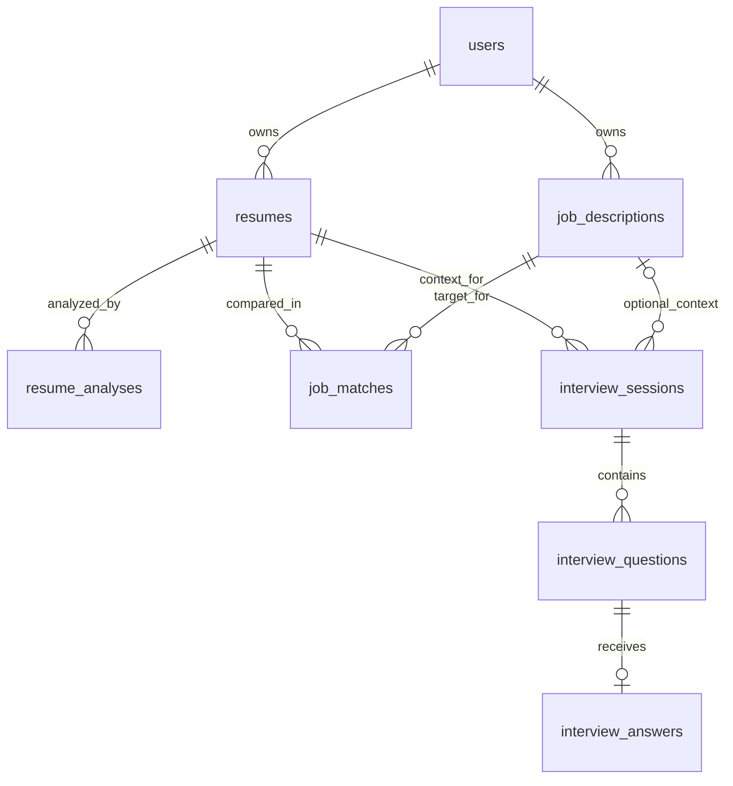

# CareerPrep AI database reference

This reference records the original migrations and follow-up design baseline. The Sprint 2 follow-up migration and its application evidence are tracked in the [sprint delivery record](06-sprint-log.md). Original Laravel fields below describe migration history, not the current authentication contract once the follow-up migration has been applied.

Snapshot: October 21, 2026. This document describes SQL in the repository; the live database was not inspected. The auth/profile additions below are proposals, not applied migrations.

## 1. Migration sources and execution order

1. [`20261014150915_initial_schema.sql`](../supabase/migrations/20261014150915_initial_schema.sql): transactionally creates private schema `careerprep`, eight application tables, constraints, query indexes, and update triggers. The header explicitly assumes Laravel-managed authentication and a private SQL connection.
2. [`20261016160000_add_walking_skeleton_config.sql`](../supabase/migrations/20261016160000_add_walking_skeleton_config.sql): creates public read-only `app_config`, enables its RLS, adds a public SELECT policy, and inserts project metadata if empty.

The first migration is intended for a new/empty Supabase project and is not a repeatable setup script. Apply new design changes through a subsequent migration with an explicit data/backfill strategy. The documentation task did not modify or execute migrations.

## 2. Current relationships



`user_id` is also present on analyses, matches, and sessions. Composite foreign keys to `(id, user_id)` on resumes and jobs ensure these relationships belong to the same user. Questions inherit ownership through their session; answers inherit it through their question. The API must use those relationships when authorizing reads and writes.

## 3. Current table fields

All eight application tables have bigint identity primary keys named `id`. Unless noted otherwise, `created_at` and `updated_at` are non-null timezone-aware timestamps defaulting to `NOW()`. Optional fields are nullable. JSONB array fields default to `[]` and have SQL checks requiring an array, but those checks do not validate item schemas.

### `careerprep.users`

| Fields | SQL shape / meaning |
| --- | --- |
| `id` | Bigint identity PK |
| `name` | Required varchar(150), nonblank |
| `email` | Required varchar(320), nonblank; unique index on `LOWER(email)` |
| `email_verified_at` | Optional timestamptz |
| `password` | Required varchar(255), intended to contain a hash under the original Laravel design |
| `remember_token` | Optional varchar(100), Laravel-oriented |
| `created_at`, `updated_at` | Required timestamps |

**Mismatch:** The confirmed Supabase Auth design will not store local password hashes or remember tokens here. Supabase identities use UUIDs, while application ownership currently uses bigint IDs. An explicit identity mapping is required; these identifiers are not interchangeable.

### `careerprep.resumes`

| Fields | SQL shape / meaning |
| --- | --- |
| `id`, `user_id` | PK and required FK to users; unique `(id, user_id)` |
| `original_filename` | Required nonblank varchar(255) |
| `storage_disk`, `storage_path` | Required varchar(40), default `supabase`; required nonblank text; unique pair |
| `mime_type` | Required varchar(120), constrained to PDF or DOCX MIME type |
| `file_size_bytes` | Required bigint, 1–10,485,760 inclusive (10 MiB maximum) |
| `extracted_text` | Optional raw text |
| `extraction_status` | Required varchar(20): `pending`, `processing`, `completed`, `failed`; defaults to `pending` |
| `extraction_error`, `extracted_at` | Optional nonblank varchar(100) error code and timestamp |
| `created_at`, `updated_at` | Required timestamps |

Files are intended to live in a private storage bucket; the migration does not create that bucket or its access policies. There are no structured resume-profile columns, display title, content hash, or durable file cleanup records.

### `careerprep.resume_analyses`

| Fields | SQL shape / meaning |
| --- | --- |
| `id`, `user_id`, `resume_id` | Required IDs; composite FK to the owned resume |
| `status` | `pending`, `processing`, `completed`, `failed`; defaults to `pending` |
| `overall_score` | Optional numeric(5,2), 0–100 |
| `summary` | Optional text |
| `strengths`, `weaknesses`, `missing_sections`, `recommendations` | Required JSONB arrays |
| `rubric_version` | Required nonblank varchar(80), default `resume-v1` |
| `model_provider`, `model_name`, `prompt_version` | Optional varchar(80), varchar(120), varchar(80) |
| `error_code`, `completed_at` | Optional varchar(100) and timestamp |
| `created_at`, `updated_at` | Required timestamps |

The current table has no component-score breakdown or source/profile snapshot. Array contents and evidence grounding are application validation responsibilities.

### `careerprep.job_descriptions`

| Fields | SQL shape / meaning |
| --- | --- |
| `id`, `user_id` | Required IDs; FK to users and unique `(id, user_id)` |
| `job_title`, `company_name` | Optional varchar(180) |
| `description_text` | Required text with trimmed length 1–30,000 |
| `created_at`, `updated_at` | Required timestamps |

There is no job-version model. Proposed initial behavior locks edits once a job has dependent results and offers creation of a new description instead.

### `careerprep.job_matches`

| Fields | SQL shape / meaning |
| --- | --- |
| `id`, `user_id`, `resume_id`, `job_description_id` | Required IDs; composite owned-resume and owned-job FKs |
| `status` | `pending`, `processing`, `completed`, `failed`; defaults to `pending` |
| `match_score` | Optional numeric(5,2), 0–100 |
| `matching_skills`, `missing_skills`, `recommendations` | Required JSONB arrays |
| `explanation` | Optional text |
| `rubric_version` | Required nonblank varchar(80), default `job-match-v1` |
| `model_provider`, `model_name`, `prompt_version` | Optional provenance strings |
| `error_code`, `completed_at` | Optional error code and timestamp |
| `created_at`, `updated_at` | Required timestamps |

Multiple matches may exist for the same resume/job pair. There is no unique pair constraint and no idempotency key. Requirement-level assessments and source snapshots are proposed additions.

### `careerprep.interview_sessions`

| Fields | SQL shape / meaning |
| --- | --- |
| `id`, `user_id`, `resume_id` | Required IDs; composite owned-resume FK; unique `(id, user_id)` |
| `job_description_id` | Optional bigint; composite owned-job FK when present |
| `status` | `pending`, `in_progress`, `completed`, `abandoned`, `failed`; defaults to `pending` |
| `question_count` | Required smallint, default 5, range 1–20 |
| `overall_score`, `summary` | Optional numeric(5,2), 0–100; optional text |
| `strengths`, `improvements` | Required JSONB arrays |
| `rubric_version` | Required nonblank varchar(80), default `interview-v1` |
| `started_at`, `completed_at` | Optional timestamps |
| `created_at`, `updated_at` | Required timestamps |

The database does not enforce that `question_count` equals the number of saved questions or that all answers are evaluated before completion. The service must enforce those rules transactionally. This table has no model/prompt provenance or source snapshot; questions/answers already carry their own model/prompt fields.

### `careerprep.interview_questions`

| Fields | SQL shape / meaning |
| --- | --- |
| `id`, `interview_session_id` | Required IDs; FK to session |
| `question_number` | Required smallint, 1–20; unique within session |
| `question_type` | Required varchar(20), default `general`; allowed `general`, `technical`, `behavioral`, `situational` |
| `question_text` | Required text; trimmed length 1–10,000 |
| `model_provider`, `model_name`, `prompt_version` | Optional provenance strings |
| `created_at` | Required timestamp; no `updated_at` or update trigger |

Question order must also be contiguous and match the intended count; uniqueness alone does not guarantee that. Questions should be stable for an interview attempt.

### `careerprep.interview_answers`

| Fields | SQL shape / meaning |
| --- | --- |
| `id`, `interview_question_id` | Required IDs; unique FK to question, allowing one answer row per question |
| `answer_text` | Required text, trimmed length 1–30,000 |
| `status` | `submitted`, `evaluating`, `evaluated`, `failed`; defaults to `submitted` |
| `relevance_score`, `clarity_score`, `completeness_score`, `examples_score`, `technical_score`, `overall_score` | Optional numeric(5,2); each constrained to 0–100 when non-null |
| `feedback` | Optional text |
| `strengths`, `suggestions` | Required JSONB arrays |
| `model_provider`, `model_name`, `prompt_version`, `error_code` | Optional provenance/error strings |
| `submitted_at` | Required timestamp, default now |
| `evaluated_at` | Optional timestamp |
| `created_at`, `updated_at` | Required timestamps |

The existing model has no answer-attempt history or answer-level rubric version. `technical_score` being nullable supports a proposed nontechnical-question rubric, but the API must enforce correct applicability and aggregation.

### `public.app_config`

Fields: `id` bigint identity PK, `project_name` required text, `created_at` required timestamp. SELECT is granted to `anon` and `authenticated`; RLS permits their reads. This is non-sensitive diagnostic metadata and is the only table read by the current backend. It is not an example of private resume authorization or full CRUD.

The seed inserts only if the table is empty, but there is no singleton constraint. The health probe fetches `limit=1` without ordering; use this for diagnostics, not application identity or authorization.

## 4. Constraints, indexes, and access behavior

### Ownership and cascade behavior

- Users -> resumes and job descriptions: `ON DELETE CASCADE`.
- Owned resumes -> analyses, matches, sessions: `ON DELETE CASCADE`.
- Owned job descriptions -> matches and sessions: `ON DELETE CASCADE`.
- Sessions -> questions -> answers: `ON DELETE CASCADE`.

Deleting a referenced job therefore deletes the interview session, its questions, and answers, even though the session's job reference is optional. This is current SQL behavior; it is not `SET NULL`. The UI must explain the consequence, or a follow-up migration must deliberately change it. Deleting a user also needs explicit object-storage cleanup; SQL cascades cannot perform that application lifecycle automatically.

The initial migration revokes `PUBLIC`, `anon`, and `authenticated` access to the private schema and its tables/sequences/functions. It does not create a Node runtime database role or per-user RLS policies on those tables. A private schema plus backend authorization is the current intended boundary; do not claim the initial schema implements user-specific RLS.

### Completion constraints

Analyses, matches, and sessions check that a non-null `completed_at` implies `status = completed`. Answers similarly check that a non-null `evaluated_at` implies `status = evaluated`. The reverse is not enforced: a completed row can still lack its timestamp, score, or required feedback. Application validation and stronger follow-up checks should enforce the final invariants where appropriate.

### Indexes and triggers

- Case-insensitive unique user email.
- Owner/creation indexes for resumes, analyses, jobs, matches, and sessions.
- Resume/time index for analysis history.
- Resume/job relationship indexes for matches and sessions.
- Unique `(session, question_number)` supports ordered question retrieval.
- Unique answer question ID supports single-answer lookup.
- `touch_updated_at()` triggers update seven mutable application tables; questions have only creation time.

## 5. Proposed follow-up migration plan

These are design requirements to review before writing SQL. None are implemented by this documentation change.

| Change | Purpose and required treatment |
| --- | --- |
| Supabase identity mapping | Add unique non-null `users.auth_user_id` UUID referencing `auth.users(id)`. For existing rows, define an explicit matching/backfill policy before requiring non-null. Keep bigint application IDs and existing ownership FKs. Do not auto-link accounts solely because a caller submits an email. |
| Remove local credential columns | After identity mapping is verified, remove `password` and `remember_token`. Decide whether profile email/verification fields remain synchronized display data; they must not become a separate login authority. |
| Runtime role/grants | Grant a dedicated server role only required schema usage, table access, sequence access, and necessary function use. Keep migration credentials separate. Keep `careerprep` out of Data API exposed schemas. |
| Resume display title | Add a validated `display_title` field, with a deliberate backfill from the original filename if desired. This supports a meaningful rename operation without altering stored file identity. |
| Structured profile | Add `careerprep.resume_profiles`: `resume_id` bigint PK, `user_id` bigint, composite owned-resume FK with cascade, `summary` nullable text, `skills`, `education`, `experience`, `projects` JSONB arrays, `schema_version`, `profile_revision` integer, `review_status`, `confirmed_at`, `model_provider`, `model_name`, `prompt_version`, timestamps. Validate nested structures in the backend and coarse JSON shapes in SQL. |
| Source provenance | Save a bounded `source_snapshot` JSONB on analyses, matches, and sessions, including the confirmed profile revision and relevant job text/version. Source files stay immutable; later profile edits create a new revision. Mark prior results as historical rather than silently recomputing them from changed inputs. Apply the same retention/deletion controls to snapshots. |
| Explainable scores | Add a checked `rubric_scores` JSONB object to analyses and a `requirement_assessments` JSONB array to matches. Add `rubric_version` to answers, or enforce and document immutable inheritance from the session. Store backend-computed aggregates in existing score columns. |
| Request deduplication | Add operation-specific idempotency keys and unique owner/key constraints for analysis, match, and interview creation. Use conditional state changes for extraction and answer evaluation. Validate key length and retention. |
| Processing recovery | Define run start/deadline metadata or an equivalent stale-run policy. Persist final failure codes, prohibit transitions that overwrite completed results, and coordinate deletion with in-flight operations. |
| File cleanup durability | Add a minimal cleanup-task/outbox record that preserves storage keys and retry state independently of cascade deletion. Backend workers or controlled retries complete storage cleanup. Final user-visible delete semantics must agree with this implementation. |
| Stronger result invariants | Where justified, require completion timestamps and required fields for terminal success, and clear incompatible terminal fields when retrying failures. Use new constraints only after checking existing data. |

Suggested new profile relationship:

```text
auth.users(id UUID)
  -> careerprep.users(auth_user_id UUID unique, id bigint PK)
      -> careerprep.resumes(user_id bigint)
          -> careerprep.resume_profiles(resume_id PK, user_id bigint)
```

Supabase Auth deletion cascading to application profiles would also cascade application rows. Account deletion must therefore be orchestrated to preserve file cleanup keys first. The exact self-service account lifecycle and retention period remain open decisions.

## 6. Migration and data-access review checklist

Before implementing the next migration: inspect the actual deployed schema and existing users; confirm migration ownership and recovery/backup procedures; design the identity backfill; establish the runtime SQL role; review storage policy and deletion semantics; document all new environment names; and demonstrate ownership with two test identities.

Database integration should use parameterized queries, short transactions, explicit `careerprep` qualification or a controlled search path, TLS, bounded pools, and decimal-string serialization of bigint identifiers. External AI calls happen outside database transactions, with a final atomic status/result commit. Do not broaden anon/authenticated grants to make the current metadata probe serve application CRUD.
