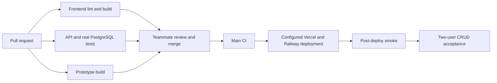

# Pipeline, environments and operations

The [course instructions](00-official-course-instructions.md) require automated deployment, an updated metrics log, environment separation and reviewed changes. The dedicated DevOps engineer owns these operational settings; repository files alone cannot prove the settings are enabled.

## Checks and triggers

`CI` runs on every pull request and every push to `main`. Independent frontend, backend and prototype jobs run in parallel; newer runs cancel obsolete runs for the same branch/PR. Jobs have timeouts and cache package downloads using the relevant lockfile.

| Job | Work | Reason |
| --- | --- | --- |
| `Install, Lint & Build` | Frozen pnpm install, ESLint, production Next.js build/type checking | Preserve the frontend quality gate. |
| `API & PostgreSQL` | Frozen backend npm install, syntax check, API behavior tests, migrations/ownership/persistence tests against PostgreSQL 16 | Exercise actual request behavior and database constraints without credentials or paid AI calls. |
| `Prototype Build` | Frozen npm install and build for the preserved Vite prototype | Keep the separate prototype buildable without delaying the independent jobs. |

The PostgreSQL service uses throwaway CI-only credentials. Its Supabase Auth/Storage fixture is test infrastructure; it never represents a real hosted login or Storage verification. Integration tests must use a fresh disposable database, never production.

`Deployment Smoke` runs after a successful production deployment event or an explicit manual run. It uses the configured production URLs, checks the frontend, a real metadata database read, private-schema readiness at `/ready` and the unauthenticated API boundary. It never calls Gemini, logs in or accesses private documents. Because services finish at different times, it retries a bounded number of times. This smoke check cannot replace the two-user authenticated rehearsal.

## Admin setup before merging

1. In the GitHub repository settings, edit the active `Protect main` ruleset. Require at least one approving teammate review and the three CI checks listed above. Keep force-push/deletion protection. The inspected ruleset currently requires PRs but zero approvals and no status checks; the implementation contributor cannot change admin settings with the current access.
2. After Railway recovers, create the authorized replacement project/service and deploy the checked backend. Configure the source for `main` with Root Directory `/backend` after the reviewed PR stack lands; connecting the earlier skeleton first would replace the reviewed test increment. Enable **Wait for CI** so a failed main workflow cannot deploy. Inspect the setting rather than assuming it is enabled. The readiness deployment check uses `/ready`, so a process with missing private-schema configuration cannot pass merely by listening. Railway describes source settings in [GitHub autodeploys](https://docs.railway.com/guides/github-autodeploys).
3. In Vercel, use the repository root and production branch `main`; keep branch preview deployments. If available on the team's plan, configure the CI checks as [Deployment Checks](https://vercel.com/docs/deployment-checks) before production promotion. Otherwise enforce the same checks/review at GitHub merge, and document the remaining post-merge promotion limitation.
4. Configure the per-environment variables below. New `NEXT_PUBLIC_` values require a frontend rebuild. Run the migration separately with the migration identity before deploying the new backend; the app must not auto-migrate with its runtime identity.
5. Set GitHub public variables `PRODUCTION_FRONTEND_URL` and `PRODUCTION_API_URL` to the accepted replacement host URLs. Until then, the smoke workflow defaults to the existing walking-skeleton URLs and must not be reported as a passing Sprint 2 deployment check. Production deployment events include Vercel `Production` and Railway environment names ending in ` / production`.

Do not enable automatic PR merging. Each dependent PR must receive a teammate review and pass its applicable checks; merge foundation, API, UI, then delivery. Change the base of the remaining stacked PRs to `main` after each dependency lands.

## Environment separation

| Setting | Development | Preview/staging | Production |
| --- | --- | --- | --- |
| Frontend | `localhost:3000` | Vercel preview/stable staging domain | Existing Vercel production domain |
| API | `localhost:8080` | Separate Railway service/environment | Existing Railway production service |
| Database/Auth/Storage | Local test stack or a development Supabase project | Dedicated non-production Supabase project/branch | Production Supabase project |
| `FRONTEND_URL` | Exact localhost origin | Exact approved preview/staging origins | Exact production frontend origin |
| Gemini | Disabled in routine tests | Separate budget-limited server key | Production server key |

Vercel Preview records already exist. A separate hosted preview API/database and their credentials were not verified during initial inspection. Do not point arbitrary preview builds at production private data. Prefer a stable staging domain added to the exact CORS allowlist; avoid wildcard access to all Vercel subdomains. See [Vercel GitHub integration](https://vercel.com/docs/git/vercel-for-github) and [Supabase connection guidance](https://supabase.com/docs/guides/database/connecting-to-postgres).

The browser receives only `NEXT_PUBLIC_API_URL`, `NEXT_PUBLIC_SUPABASE_URL` and `NEXT_PUBLIC_SUPABASE_ANON_KEY`. Supabase's public anon/publishable key is for Auth; the browser does not receive a service key or private SQL credentials. Backend runtime variables belong in Railway; the migration credential belongs in a separate operator environment. Use the committed templates as the authoritative variable names.

## Deployment and rollback runbook

Before release, the DevOps engineer should record the last good frontend and backend deployment IDs/commit, database backup/recovery capability and exact target environment. Inspect the new migration against current schema/data, apply once with a separate migration identity, and provision the limited runtime login. Never seed real production accounts or private resumes as part of startup.

After a reviewed merge and successful checks, watch both hosting deployments. Run `Deployment Smoke` and the [sprint acceptance checklist](06-sprint-log.md). Verify sign-up/confirmation and token refresh with real Supabase Auth, both supported document formats, reload persistence, cross-user isolation and file deletion. Record URLs, commit, CI run and outcomes without tokens, source documents or personal data. Check the authenticated Gemini connectivity probe once with the actual server key to finish the Sprint 1 provider gate; routine CI must not use a paid model.

If release fails, use the Vercel project's deployment history to promote/redeploy the last good frontend and the Railway service's deployment history to redeploy the last good backend. Check both health and the previous working user journey after rollback. Record start, detection and recovery times. This follow-up migration is additive for resume metadata/cleanup but removes unused legacy password columns; do not attempt an unreviewed SQL reversal or restore a database without assessing writes since backup. The old walking skeleton does not use those columns. A database rollback needs a separate reviewed recovery plan.

Rollback has not been exercised against the hosted services in this session. The team must rehearse it and attach actual evidence before claiming release readiness.

## Measured baseline and optimization log

Values below use GitHub Actions **job start to job completion**, excluding queue time, from the original single-job pipeline. They are a small observed sample, not a complete historical sprint report. Deployment time is a separate measure.

| Sample | Runs | Result |
| --- | --- | --- |
| Earlier PR baseline | 39622102837, 38885338247, 38882581114, 38882078778, 38879682561 | 32, 23, 28, 32, 24 seconds; mean **27.8 s (0.46 min)** |
| Earlier main baseline | 39622375992, 38882681889, 38882124838, 38879815725 | 22, 29, 26, 24 seconds; mean **25.25 s (0.42 min)** |
| Sample success rate | The nine runs above | **9/9, 100%** |
| Foundation PR #21 | 39636359817 | **35 s (0.58 min)**, passed |
| API PR #22, commit `e3261fb` | 39644199157 | API/PostgreSQL **24 s**, frontend **28 s**, prototype **13 s**; all passed |
| UI PR #23, commit `8875625` | 39645066887 | API/PostgreSQL **21 s**, frontend **32 s**, prototype **12 s**; all passed |
| Delivery PR #24, commit `e9f1dcb` | 39647136503 | API/PostgreSQL **27 s**, frontend **34 s**, prototype **11 s**; all passed |

Sources: [main baseline](https://github.com/s2301945-rgb/careerprep-ai/actions/runs/39622375992), [foundation PR](https://github.com/s2301945-rgb/careerprep-ai/actions/runs/39636359817); other run IDs can be opened under this repository's Actions page.

| Sprint | Avg PR pipeline time | Main time | Success rate | Production deploys | Merge-to-live | Failed deploys | Recovery | Change |
| --- | --- | --- | --- | --- | --- | --- | --- | --- |
| 1 baseline sample | 0.46 min job time | 0.42 min job time | 100% of 9 sampled runs | Not fully measured | Not measured | Not fully measured | Not measured | Existing cached install/lint/build pipeline |
| 2 implementation | Recorded API/UI/delivery runs: longest jobs 28/32/34 s; mean 31.3 s (0.52 min), excluding queue time | Pending merge | 3/3 recorded runs passed | Replacement frontend setup deployment ready; full-stack acceptance pending | Pending merge | Railway rejected project creation during provider outage | Pending provider recovery | Add API/PostgreSQL tests, parallel jobs, cancellation and bounded smoke |
| 3 | Pending | Pending | Pending | Pending | Pending | Pending | Pending | Planned |
| 4 | Pending | Pending | Pending | Pending | Pending | Pending | Pending | Planned |

Optimization hypothesis: separating independent jobs and cancelling obsolete runs improves feedback and avoids wasted work. The backend job adds meaningful coverage, so a runtime increase alone is not a regression. Record the new wall-clock/queue measurements before claiming an improvement; no before/after speedup has been established yet.

## Incident record

No new main/production incident has been established from this implementation. The live Gemini probe reporting missing configuration is an observed acceptance blocker; its start time/root cause have not been established. Do not rewrite it as a verified historical outage. For an actual incident, record timestamp/environment/commit, impact, root cause, fix, prevention and recovery duration here.

On October 22, 2026 (Asia/Manila), replacement Railway project creation was blocked by `Deploys have been paused temporarily`. The provider's [status page](https://status.railway.com/) reported an active dashboard/API/build outage beginning October 21 UTC. No new deployment was started and no replacement project was created. This blocks delivery, rather than demonstrating a failure or recovery of our production app. Recovery time remains unmeasured. Separately, the local hosted-provider Gemini rehearsal's 2.5-model 404 was resolved by the documented, verified `gemini-3.5-flash-lite` configuration; the existing Railway environment has not received that change.
