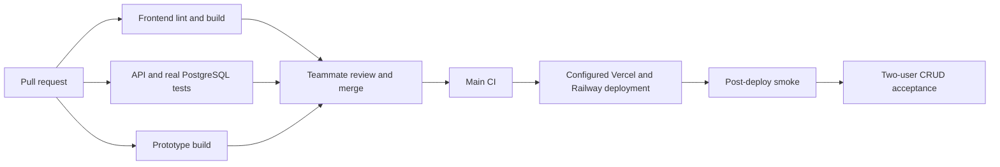

# Pipeline, environments and operations

The [course instructions](00-official-course-instructions.md) require automated deployment, an updated metrics log, environment separation and reviewed changes. The dedicated DevOps engineer owns these operational settings; repository files alone cannot prove the settings are enabled.

## Checks and triggers

`CI` runs on every pull request and every push to `main`. Independent frontend, backend and prototype jobs run in parallel; newer runs cancel obsolete runs for the same branch/PR. Jobs have timeouts and cache package downloads using the relevant lockfile.

| Job | Work | Reason |
| --- | --- | --- |
| `Install, Lint & Build` | Frozen pnpm install, ESLint, production Next.js build/type checking | Preserve the frontend quality gate. |
| `API & PostgreSQL` | Frozen backend npm install, syntax check, API behavior tests, migrations/ownership/persistence tests against PostgreSQL 16 | Exercise actual request behavior and database constraints without credentials or paid AI calls. |
| `Prototype Build` | Frozen npm install and build for the preserved Vite prototype | Keep the separate prototype buildable without delaying the independent jobs. |

Each job also audits its production dependency graph and fails on high or critical advisories. These registry checks do not certify application security or cover every development dependency. The backend declares Node.js `22.x`, matching CI, instead of allowing Railpack to select Node.js 20, which is [end of life](https://nodejs.org/en/about/eol). Verify the selected runtime in the actual deployment build before claiming production alignment.

The PostgreSQL service uses throwaway CI-only credentials. Its Supabase Auth/Storage fixture is test infrastructure; it never represents a real hosted login or Storage verification. Integration tests must use a fresh disposable database, never production.

`Deployment Smoke` runs after a successful production deployment event or an explicit manual run. It checks that the deployed frontend was built with the expected API origin and that the API accepts browser requests from the frontend. It also verifies the database read, `/ready` and the signed-out resume API boundary. The chosen production frontend needs a build containing this check's origin marker and the intended `NEXT_PUBLIC_API_URL`. The workflow retries while hosts finish deploying. Run the two-user authenticated rehearsal separately to verify private uploads and live AI.

## Admin setup before merging

1. In the GitHub repository settings, edit the active `Protect main` ruleset. Require at least one approving teammate review and the three CI checks listed above. Keep force-push/deletion protection. The inspected ruleset currently requires PRs but zero approvals and no status checks; the implementation contributor cannot change admin settings with the current access.
2. Use the existing Railway `capable-unity` project and `careerprep-ai` service. Its current source is `main`; verify Root Directory `/backend` and enable **Wait for CI** after the reviewed PR stack lands. Inspect the settings rather than assuming they are enabled. Change the live health check from `/` to `/ready` so a process with missing private-schema configuration cannot pass merely by listening. Railway describes source settings in [GitHub autodeploys](https://docs.railway.com/guides/github-autodeploys).
3. In Vercel, use the repository root and production branch `main`; keep branch preview deployments. If available on the team's plan, configure the CI checks as [Deployment Checks](https://vercel.com/docs/deployment-checks) before production promotion. Otherwise enforce the same checks/review at GitHub merge, and document the remaining post-merge promotion limitation.
4. Configure the per-environment variables below. New `NEXT_PUBLIC_` values require a frontend rebuild. Run the migration separately with the migration identity before deploying the new backend; the app must not auto-migrate with its runtime identity.
5. Set GitHub public variables `PRODUCTION_FRONTEND_URL` and `PRODUCTION_API_URL` to the accepted host URLs. The smoke workflow fails when either variable is missing; it does not fall back to old walking-skeleton URLs. Production deployment events include Vercel `Production` and Railway environment names ending in ` / production`.

Do not enable automatic PR merging. Each dependent PR must receive a teammate review and pass its applicable checks; merge foundation, API, UI, then delivery. Change the base of the remaining stacked PRs to `main` after each dependency lands.

## Frontend deployment after main CI

`Frontend Production Deployment` in [frontend-deploy.yml](../.github/workflows/frontend-deploy.yml) deploys the existing `careerprep-ai-demo-221a` Vercel project after a successful push-triggered `CI` run on `main` in this repository. It reads the current `main` SHA, checks successful CI for that exact commit, and checks out the verified commit. Fork and pull-request CI runs cannot select deployment source. A manual run must use `main` and pass the same current-commit CI check. The workflow file must first be merged into `main` for these triggers to be available.

The production jobs run one at a time and recheck `main` immediately before deployment. Superseded commits are skipped. Vercel CLI `66.2.0` pulls the project's Production settings, builds once and uploads with `--prebuilt --prod`. The deployment runner uses Node.js 22, matching normal CI. The Vercel project used Node.js 26 at the November 19 inspection. The approved November 20 setup changed it to `22.x` and successfully built frontend revision `3998f66`; see the [deployment record](evidence/frontend-deployment-2026-11-20.json). This workflow does not change that project setting. The uploaded deployment carries `sourceCommit` and `githubActionsRun` metadata.

The repository owner or another administrator must add these three **Actions repository secrets** under **Settings > Secrets and variables > Actions** before the first deployment:

| Secret | Source and destination |
| --- | --- |
| `VERCEL_TOKEN` | A deployment token created by the owner of the Vercel scope `wazapzjavellana-2496`. Enter it directly as the repository secret. |
| `VERCEL_ORG_ID` | The scope ID returned by linking this existing project in the Vercel CLI, in the ignored `.vercel/project.json`. Use the ID rather than the scope's display name. |
| `VERCEL_PROJECT_ID` | The existing `careerprep-ai-demo-221a` project ID, `prj_ST3K2ppxXVUwD1LDUu7EAl456Kra`. |

The Vercel project owner must configure Production variables `NEXT_PUBLIC_API_URL`, `NEXT_PUBLIC_SUPABASE_URL` and `NEXT_PUBLIC_SUPABASE_ANON_KEY`. The first must point to the working Railway API. The Supabase browser key must be a public anon or publishable key. The project had no stored Production variables at the November 19 inspection, so its earlier manual deployment does not prove these settings are ready for a fresh build. The workflow checks the downloaded settings before building and fails with variable names if configuration is missing or unsafe. The GitHub public variables `PRODUCTION_FRONTEND_URL` and `PRODUCTION_API_URL` must identify the accepted website and API for the smoke check. Deployment secrets are checked by name, and the downloaded environment file is removed during job cleanup.

After Vercel reports readiness, the workflow checks the configured production URL through Vercel's alias API. Its project ID must match the configured project and its deployment URL must match the CLI result. Six bounded attempts allow alias propagation, with five seconds between attempts and a ten-second request timeout. An old healthy alias cannot satisfy this check. The workflow then runs the existing production smoke script and records the final result as a GitHub `Production` deployment on the actual source SHA. Deployment records include a link to the workflow run and, after successful upload, the Vercel deployment URL. A deployment status made with `GITHUB_TOKEN` does not trigger the separate smoke workflow, so the deployment job runs that check directly. The independent `Deployment Smoke` workflow continues to handle hosting-provider events.

As of this implementation the frontend project was deployed through Vercel Drop and had no native Git connection. Vercel requires the owner of a personal GitHub repository to connect it through the native integration; this contributor is a collaborator on the classmate-owned repository. This workflow uses Vercel's documented GitHub Actions/CLI deployment path. Adding the file alone does not prove deployment works. Record the first main CI run, deployment run, source SHA, production URL and smoke result after the secrets are configured.

References are Vercel's [GitHub Actions guide](https://vercel.com/kb/guide/how-can-i-use-github-actions-with-vercel), [deployment metadata](https://vercel.com/docs/cli/deploy#meta), [alias API](https://vercel.com/docs/rest-api/aliases/get-an-alias) and [GitHub repository permissions](https://vercel.com/docs/git/vercel-for-github#missing-git-repository), plus GitHub's [workflow-run trigger](https://docs.github.com/en/actions/reference/workflows-and-actions/events-that-trigger-workflows#workflow_run) and [workflow token event behavior](https://docs.github.com/en/actions/how-tos/write-workflows/choose-when-workflows-run/trigger-a-workflow#triggering-a-workflow-from-a-workflow).

## Environment separation

| Setting | Development | Preview/staging | Production |
| --- | --- | --- | --- |
| Frontend | `localhost:3000` | Vercel preview/stable staging domain | Existing Vercel production domain |
| API | `localhost:8080` | Separate Railway service/environment | Existing Railway production service |
| Database/Auth/Storage | Local test stack or a development Supabase project | Dedicated non-production Supabase project/branch | Production Supabase project |
| `FRONTEND_URL` | Exact localhost origin | Exact approved preview/staging origins | Exact production frontend origin |
| Groq | Disabled in routine tests | Separate rate-limited server key | Production server key |

Vercel Preview records already exist. A separate hosted preview API/database and their credentials were not verified during initial inspection. Do not point arbitrary preview builds at production private data. Prefer a stable staging domain added to the exact CORS allowlist; avoid wildcard access to all Vercel subdomains. See [Vercel GitHub integration](https://vercel.com/docs/git/vercel-for-github) and [Supabase connection guidance](https://supabase.com/docs/guides/database/connecting-to-postgres).

The browser receives only `NEXT_PUBLIC_API_URL`, `NEXT_PUBLIC_SUPABASE_URL` and `NEXT_PUBLIC_SUPABASE_ANON_KEY`. Supabase's public anon/publishable key is for Auth; the browser does not receive a service key or private SQL credentials. Backend runtime variables belong in Railway; the migration credential belongs in a separate operator environment. Use the committed templates as the authoritative variable names.

## Deployment and rollback runbook

Before release, the DevOps engineer should record the last good frontend and backend deployment IDs/commit, database backup/recovery capability and exact target environment. Inspect the new migration against current schema/data, apply once with a separate migration identity, and provision the limited runtime login. Never seed real production accounts or private resumes as part of startup.

After a reviewed merge and successful checks, watch both hosting deployments. Run `Deployment Smoke` and the [sprint acceptance checklist](06-sprint-log.md). Verify sign-up/confirmation and token refresh with real Supabase Auth, both supported document formats, reload persistence, cross-user isolation and file deletion. Record URLs, commit, CI run and outcomes without tokens, source documents or personal data. Check the authenticated Groq connectivity probe once with the actual server key to finish the Sprint 1 provider gate; routine CI must not call a live model.

If release fails, use the Vercel project's deployment history to promote/redeploy the last good frontend and the Railway service's deployment history to redeploy the last good backend. Check both health and the previous working user journey after rollback. Record start, detection and recovery times. This follow-up migration is additive for resume metadata/cleanup but removes unused legacy password columns; do not attempt an unreviewed SQL reversal or restore a database without assessing writes since backup. The old walking skeleton does not use those columns. A database rollback needs a separate reviewed recovery plan.

Rollback has not been exercised against the hosted services in this session. The team must rehearse it and attach actual evidence before claiming release readiness.

## Measured baseline and optimization log

Values below use GitHub Actions **job start to job completion**, excluding queue time, from the original single-job pipeline. They are a small observed sample, not a complete historical sprint report. Deployment time is a separate measure.

| Sample | Runs | Result |
| --- | --- | --- |
| Earlier PR baseline | 39622102837, 38885338247, 38882581114, 38882078778, 38879682561 | 32, 23, 28, 32, 24 seconds; mean **27.8 s (0.46 min)** |
| Earlier main baseline | 39622375992, 38882681889, 38882124838, 38879815725 | 22, 29, 26, 24 seconds; mean **25.25 s (0.42 min)** |
| Sample success rate | The nine runs above | **9/9, 100%** |
| Foundation PR #21 | 39636359817 | **35 s (0.58 min)**, passed |
| API PR #22, commit `e3261fb` | 39644199157 | API/PostgreSQL **24 s**, frontend **28 s**, prototype **13 s**; all passed |
| UI PR #23, commit `8875625` | 39645066887 | API/PostgreSQL **21 s**, frontend **32 s**, prototype **12 s**; all passed |
| Delivery PR #24, commit `e9f1dcb` | 39647136503 | API/PostgreSQL **27 s**, frontend **34 s**, prototype **11 s**; all passed |

Sources: [main baseline](https://github.com/s2301945-rgb/careerprep-ai/actions/runs/39622375992), [foundation PR](https://github.com/s2301945-rgb/careerprep-ai/actions/runs/39636359817); other run IDs can be opened under this repository's Actions page.

| Sprint | Avg PR pipeline time | Main time | Success rate | Production deploys | Merge-to-live | Failed deploys | Recovery | Change |
| --- | --- | --- | --- | --- | --- | --- | --- | --- |
| 1 baseline sample | 0.46 min job time | 0.42 min job time | 100% of 9 sampled runs | Not fully measured | Not measured | Not fully measured | Not measured | Existing cached install/lint/build pipeline |
| 2 implementation | Recorded API/UI/delivery runs: longest jobs 28/32/34 s; mean 31.3 s (0.52 min), excluding queue time | Pending merge | 3/3 recorded runs passed | Replacement frontend setup deployment ready; full-stack acceptance pending | Pending merge | Railway rejected project creation during provider outage | Pending provider recovery | Add API/PostgreSQL tests, parallel jobs, cancellation and bounded smoke |
| 3 | Two Week 3 PR runs: longest jobs 35.67 s and 19.34 s | Pending merge | 2/2 recorded runs passed | Pending | Pending | Pending | Pending | Mocked AI and PostgreSQL integration |
| 4 | One recorded PR run, longest job 75 s (1.25 min), excluding queue time | Pending merge | 1/1 recorded run passed | Protected preview built, production pending | Pending merge | Pending | Pending | Persist `.next/cache` across eligible CI runs |

Optimization hypothesis: separating independent jobs and cancelling obsolete runs improves feedback and avoids wasted work. The backend job adds meaningful coverage, so a runtime increase alone is not a regression. Record the new wall-clock/queue measurements before claiming an improvement; no before/after speedup has been established yet.

### November 20 release-recheck sample

For main `328c9f7`, [CI run 44580202191](https://github.com/s2301945-rgb/careerprep-ai/actions/runs/44580202191) passed all three jobs. GitHub job start/completion timestamps give frontend **24 s**, API/PostgreSQL **29 s**, and prototype **9 s**, excluding queue time. This is one observed run, not a four-sprint trend or an optimization comparison. Railway automatically deployed that main revision and its smoke passed. The frontend workflow initially failed at absent secrets and then an invalid copied token; after approved correction, [attempt 3](https://github.com/s2301945-rgb/careerprep-ai/actions/runs/44580304795/attempts/3) succeeded, including exact alias and smoke verification. That manual retry is recovery evidence, not the continuous Deployment Challenge. The [aggregate checkpoint](evidence/release-recheck-2026-11-20.json) records IDs, actual outcomes and remaining limits without credential values or personal document data.

### Week 4 cache measurement

The existing pnpm dependency cache missed in [Week 3 run 42392368562](https://github.com/s2301945-rgb/careerprep-ai/actions/runs/42392368562/job/128462438624) and restored in [run 42394234735](https://github.com/s2301945-rgb/careerprep-ai/actions/runs/42394234735/job/128468060670). The install logs report 6.9 seconds and 3.4 seconds respectively. This is a two-run observation with runner and network variation. Both runs reported a missing Next.js build cache.

Week 4 adds a separate cache for `.next/cache`, keyed by runner OS, architecture, Node major version, lockfile and frontend inputs. The workflow still installs dependencies, lints, and builds on cache hits. In a local Windows run using the same frozen dependencies and source, the first production build took 19.93 seconds wall time and the immediate warm build took 13.90 seconds (6.03 seconds faster, about 30%). Both builds passed and produced the Turbopack cache directory.

The hosted frontend job took 21 seconds (7 seconds for the build) in [Week 3 run 42394234735](https://github.com/s2301945-rgb/careerprep-ai/actions/runs/42394234735/job/128468060670) and 75 seconds (9 seconds for the build) in [Week 4 run 42405096043](https://github.com/s2301945-rgb/careerprep-ai/actions/runs/42405096043/job/128500962800). The Week 4 Node setup cleanup step alone took 46 seconds. This pair uses different revisions and runners, so it does not establish a hosted cache improvement. Compare matched cold and warm hosted runs to isolate the cache effect.

## Incident record

No new main/production incident has been established from this implementation. The live Gemini probe reporting missing configuration is an observed acceptance blocker; its start time/root cause have not been established. Do not rewrite it as a verified historical outage. For an actual incident, record timestamp/environment/commit, impact, root cause, fix, prevention and recovery duration here.

On October 22, 2026 (Asia/Manila), replacement Railway project creation was blocked by `Deploys have been paused temporarily`. The provider's [status page](https://status.railway.com/) reported an active dashboard/API/build outage beginning October 21 UTC. No new deployment was started and no replacement project was created. This blocks delivery, rather than demonstrating a failure or recovery of our production app. Recovery time remains unmeasured. Separately, the local hosted-provider Gemini rehearsal's 2.5-model 404 was resolved by the documented, verified `gemini-3.5-flash-lite` configuration; the existing Railway environment has not received that change.
